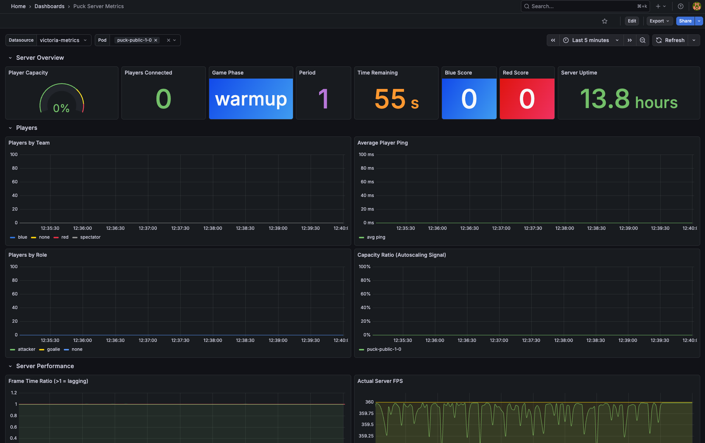

# PuckMetrics

This mod is a server-side mod that exposes game server metrics in Prometheus format. The idea is to be able to track and alert based on server performance (tickrate, frame overruns, etc). It also exposes some game-state information to aid in autoscaling.



## Installation

Installation just involves copying the `PuckMetrics.dll` file (found under the release assets) to the servers `Plugins/PuckMetrics/` folder (the TLAN production images use `Plugins/metrics/`; any folder under `Plugins/` works).

Built against Puck B1235: the physics-step collectors rely on `PhysicsManager.OnBeforeSimulate` / `OnAfterSimulate` and on the replication send being driven from the fixed step, both introduced in that build.

## Endpoints

| Path | Description |
|------|-------------|
| `GET /metrics` | Prometheus exposition format (text/plain) |
| `GET /health` | Simple `ok` response for liveness probes |

Default: `http://<server-ip>:9100/metrics`

## Configuration

| Option | Default | Description |
|--------|---------|-------------|
| `Port` | `9100` | TCP port for the metrics HTTP server |
| `UpdateIntervalSeconds` | `2.0` | How often gauge metrics are recalculated (seconds). Counters are always instant. |
| `EnablePerPlayerMetrics` | `false` | Expose per-player ping metrics (high cardinality; enable with caution) |
| `BindAddress` | `0.0.0.0` | Address to bind the listener. Use `127.0.0.1` to restrict to localhost. |
| `EnableTickTiming` | `true` | Physics-step cadence from `PhysicsManager.OnBeforeSimulate/OnAfterSimulate` (no Harmony). |
| `EnableSyncTickTiming` | `true` | Harmony-time `SynchronizedObjectManager.Server_Tick` (the replication send). |
| `EnableStageTiming` | `true` | Per player-loop-stage timing via begin/end markers. |
| `EnableEngineHealth` | `true` | Sync-state / network-object / log-size / process gauges. |
| `EnableTransportStats` | `true` | Unity Transport driver byte/packet counters and receive-stall watch. |
| `EnableProcStats` | `true` | `/proc/self` scheduler evidence (Linux only; silently off elsewhere). |
| `EnableModTiming` | `false` | Harmony-time `Update/FixedUpdate/LateUpdate` and simulate-event subscribers of mod assemblies. Detours every timed method; turn on for an attribution run, not as a standing setting. |
| `ModTimingAssemblyPrefixes` | `["TLAN","PuckMetrics"]` | Assembly-name prefixes that mod timing applies to. |
| `SceneCountIntervalSeconds` | `300` | Cadence of the scene-wide transform census (one ~10 ms frame each); `0` disables. |

If the config file is missing, all defaults are used. The file is read with Unity's `JsonUtility`, so keys that are absent keep their defaults.

## Metrics Reference

### Server Info

| Metric | Type | Labels | Description |
|--------|------|--------|-------------|
| `puck_server_info` | gauge | `server_name`, `game_mode`, `level`, `max_players`, `tick_rate`, `physics_tick_rate` | Static server metadata (always 1). `tick_rate` is the configured `serverConfig.tickRate`, `physics_tick_rate` the fixed-step rate |
| `puck_server_uptime_seconds` | gauge | - | Seconds since the plugin started |
| `puck_network_tick_rate` | gauge | - | Replication send rate. Since B1235 this equals the physics fixed-step rate (`PhysicsManager.TickRate`, 100), not `serverConfig.tickRate` |
| `puck_target_frame_rate` | gauge | - | `Application.targetFrameRate`: the main-loop cap (`serverConfig.tickRate` on a dedicated server, which also sets the client input send rate) |
| `puck_physics_tick_rate` | gauge | - | Physics fixed-step rate |
| `puck_physics_tick_interval_seconds` | gauge | - | `1 / puck_physics_tick_rate` |

### Players / Connections

| Metric | Type | Labels | Description |
|--------|------|--------|-------------|
| `puck_players_connected` | gauge | - | Total connected players |
| `puck_players_by_team` | gauge | `team` | Players per team (`blue`, `red`, `spectator`, `none`) |
| `puck_players_by_role` | gauge | `role` | Players per role (`attacker`, `goalie`, `none`) |
| `puck_player_capacity_ratio` | gauge | - | `connected / maxPlayers` (0.0–1.0) |
| `puck_average_player_ping_milliseconds` | gauge | - | Mean ping across all players |
| `puck_player_ping_max_milliseconds` | gauge | - | Highest ping among connected players (0 when empty) |
| `puck_player_ping_min_milliseconds` | gauge | - | Lowest ping among connected players (0 when empty) |
| `puck_player_ping_milliseconds` | gauge | `steam_id`, `username` | Per-player ping (requires `EnablePerPlayerMetrics`) |

### Game State

| Metric | Type | Labels | Description |
|--------|------|--------|-------------|
| `puck_game_phase` | gauge | `phase` | Current phase (info-style, value=1 for active phase) |
| `puck_game_period` | gauge | - | Current period number |
| `puck_game_tick_seconds_remaining` | gauge | - | Countdown timer for the current phase |
| `puck_game_overtime` | gauge | - | `1` if in overtime, `0` otherwise |
| `puck_game_score` | gauge | `team` | Current score per team (`blue`, `red`) |
| `puck_game_phase_is_warmup` | gauge | - | `1` if in warmup (server accepting players) |
| `puck_game_phase_is_active` | gauge | - | `1` if in active play |

Possible `phase` values: `none`, `warmup`, `pregame`, `faceoff`, `play`, `bluescore`, `redscore`, `replay`, `intermission`, `gameover`, `postgame`

### Scoring Events (Counters)

| Metric | Type | Labels | Description |
|--------|------|--------|-------------|
| `puck_goals_total` | counter | `team` | Total goals scored (`blue`, `red`) |
| `puck_games_completed_total` | counter | - | Total games that reached PostGame |

### Server Performance

Frame-level view of the main loop. On B1235 the frame cap (`targetFrameRate`, 360 in production) is much faster than the 100 Hz physics step, so these say whether the *main loop* keeps up; the physics-step cadence tables below say whether the *simulation and state send* keep up, which is what clients feel.

| Metric | Type | Labels | Description |
|--------|------|--------|-------------|
| `puck_actual_fps` | gauge | - | Actual server FPS (should match `puck_target_frame_rate`) |
| `puck_frame_time_avg_seconds` | gauge | - | Average frame time over collection interval |
| `puck_frame_time_p90_seconds` | gauge | - | 90th percentile frame time |
| `puck_frame_time_p99_seconds` | gauge | - | 99th percentile frame time (spike detection) |
| `puck_frame_time_max_seconds` | gauge | - | Worst frame time in the interval |
| `puck_frame_time_ratio` | gauge | - | `avg_frame_time / (1 / targetFrameRate)` - >1.0 means the main loop cannot hold its cap |
| `puck_frame_overruns_total` | counter | - | Frames longer than one physics tick interval (a fixed step landed in the frame, likely two) |
| `puck_physics_starvation_total` | counter | - | Frames longer than two physics tick intervals (Unity ran 2+ fixed steps and 2+ state sends back-to-back) |
| `puck_frames_over_50ms_total` | counter | - | Frames longer than 50 ms (visible hitches) |
| `puck_gc_collections_total` | counter | `generation` | GC collections per generation (0, 1, 2) - correlates with frame spikes |
| `puck_gc_memory_bytes` | gauge | - | Current managed heap size |

### Physics Step Cadence

PhysX runs from Unity's fixed-step loop (100 Hz) and `SynchronizedObjectManager` sends state to every client once per step from `PhysicsManager.OnAfterSimulate`. Two things make clients stutter and neither shows in frame times: a long frame makes Unity run several fixed steps back-to-back (several state sends leave in one frame: a gap, then a burst), and the wall-clock gap between steps stretches when the process is not scheduled.

| Metric | Type | Labels | Description |
|--------|------|--------|-------------|
| `puck_physics_steps_total` | counter | - | Fixed physics steps executed |
| `puck_physics_steps_per_second` | gauge | - | Steps achieved per wall-clock second. Below `tick_rate × time_scale` means Unity's `maximumDeltaTime` clamp is discarding simulation time |
| `puck_physics_step_seconds_total` | counter | - | Main-thread seconds between `OnBeforeSimulate` and `OnAfterSimulate`. The span contains PhysX, every other `FixedUpdate` script, collision callbacks and earlier `OnAfterSimulate` subscribers (normally `Server_Tick`) |
| `puck_physics_step_max_seconds` | gauge | - | Longest single before→after span in the interval |
| `puck_physics_step_interval_avg_seconds` | gauge | - | Average wall-clock gap between consecutive steps (slow-motion steps excluded) |
| `puck_physics_step_interval_p99_seconds` | gauge | - | 99th percentile gap |
| `puck_physics_step_interval_max_seconds` | gauge | - | Longest gap in the interval |
| `puck_physics_late_steps_total` | counter | `threshold` (`2x`, `5x`) | Steps whose gap from the previous step exceeded N × the tick interval |
| `puck_physics_slowmo_steps_total` | counter | - | Steps taken with `Time.timeScale < 1` (goal replays); excluded from the late-step accounting |
| `puck_physics_bunched_frames_total` | counter | - | Frames that ran 2 or more fixed steps (catch-up). The direct proxy for client-visible stutter |
| `puck_physics_catchup_steps_total` | counter | - | Extra steps beyond the first in bunched frames |
| `puck_physics_max_steps_per_frame` | gauge | - | Most fixed steps in one frame during the interval (1 = healthy) |
| `puck_time_scale` | gauge | - | `Time.timeScale` at the last step |
| `puck_time_scale_min` | gauge | - | Lowest `Time.timeScale` seen in the interval |

### Replication Send

| Metric | Type | Labels | Description |
|--------|------|--------|-------------|
| `puck_sync_ticks_total` | counter | - | `SynchronizedObjectManager.Server_Tick` calls |
| `puck_sync_tick_seconds_total` | counter | - | Main-thread seconds inside `Server_Tick` (snapshot capture, per-client send planning, RPC send) |
| `puck_sync_tick_max_seconds` | gauge | - | Slowest `Server_Tick` in the interval |

### Attribution

| Metric | Type | Labels | Description |
|--------|------|--------|-------------|
| `puck_stage_seconds_total` | counter | `stage` | Main-thread seconds per top-level player-loop stage (`EarlyUpdate`, `FixedUpdate`, `Update`, ...) |
| `puck_stage_max_seconds` | gauge | `stage` | Slowest single pass of a stage in the interval |
| `puck_mod_frame_seconds_total` | counter | `mod`, `hook` | Main-thread seconds in a mod assembly's `Update` / `FixedUpdate` / `LateUpdate` / `OnBeforeSimulate` / `OnAfterSimulate` (requires `EnableModTiming`) |
| `puck_mod_frame_max_seconds` | gauge | `mod`, `hook` | Slowest single invocation in the interval |

### Engine Health

| Metric | Type | Labels | Description |
|--------|------|--------|-------------|
| `puck_sync_player_states` | gauge | - | `SynchronizedPlayerState` entries held by the replication manager; should equal `puck_connected_clients`, divergence is a leak |
| `puck_connected_clients` | gauge | - | Netcode connected clients |
| `puck_network_objects` | gauge | - | Spawned `NetworkObject`s |
| `puck_pucks_spawned` | gauge | - | Live puck objects |
| `puck_scene_transforms` | gauge | - | Transforms in the scene (slow cadence, see `SceneCountIntervalSeconds`) |
| `puck_log_file_bytes` | gauge | - | Size of the game's own `Puck.log` |
| `puck_process_working_set_bytes` | gauge | - | Resident memory of the server process |
| `puck_process_handles` | gauge | - | OS handle count (where supported) |

### Transport (Unity Transport driver)

| Metric | Type | Labels | Description |
|--------|------|--------|-------------|
| `puck_transport_tx_bytes_total` / `puck_transport_rx_bytes_total` | counter | - | Wire bytes sent / received, accumulated across driver restarts |
| `puck_transport_tx_packets_total` / `puck_transport_rx_packets_total` | counter | - | Packets sent / received |
| `puck_transport_rx_stall_max_seconds` | gauge | - | Longest span in the interval during which the received-packet count did not change. With a lobby sending input, a stall over ~100 ms means the socket was not drained |
| `puck_transport_driver_resets_total` | counter | - | Times the driver statistics restarted from zero |

### Process / Scheduler (Linux only)

Read from `/proc/self`. Unity's main thread is the process's initial thread, so the thread-group leader's `schedstat` is exactly the game thread.

| Metric | Type | Labels | Description |
|--------|------|--------|-------------|
| `puck_main_thread_cpu_seconds_total` | counter | - | CPU time consumed by the main thread |
| `puck_main_thread_runqueue_wait_seconds_total` | counter | - | Time the main thread was runnable but waiting for a CPU. **The direct in-process evidence of CPU contention or hypervisor steal** |
| `puck_main_thread_timeslices_total` | counter | - | Timeslices the main thread got |
| `puck_process_cpu_seconds_total` | counter | `mode` (`user`, `system`) | CPU seconds of the whole process |
| `puck_process_threads` | gauge | - | Threads in the process |
| `puck_process_ctxt_switches_total` | counter | `type` (`voluntary`, `nonvoluntary`) | Context switches of the main thread; nonvoluntary = preempted |
| `puck_process_rss_bytes` | gauge | - | Resident set size |

#### Understanding Performance Metrics

- **`puck_physics_bunched_frames_total` rate** - the number that maps to what players call "stutter": frames in which 2+ state sends left back-to-back. Zero is normal.
- **`puck_physics_step_interval_p99_seconds` above 0.02** - steps are arriving late. Look at the next two bullets to see why.
- **`puck_main_thread_runqueue_wait_seconds_total` rate rising with bunched frames** - the game thread wanted a CPU and did not get one: node contention or steal. Compare with `node_schedstat_waiting_seconds_total` and PSI on the node.
- **Bunched frames without run-queue wait** - our own frame cost. `puck_sync_tick_max_seconds` vs `puck_physics_step_max_seconds` vs `puck_stage_max_seconds{stage="FixedUpdate"}` tells whether it is the state send, the physics span, or something else in the fixed stage; `puck_mod_frame_*` (with `EnableModTiming`) names the mod.
- **`puck_physics_steps_per_second` below `tick_rate × time_scale`** - the server is simulating slower than real time; worse than bunching.
- **`puck_frame_time_p99_seconds` spikes** - occasional frame spikes (often GC). Check `puck_gc_collections_total` rate.
- **`puck_transport_rx_stall_max_seconds` spikes** - the socket was not drained; usually the same scheduling gap seen in the step interval.

## Kubernetes Integration

### Prometheus Scraping

Add pod annotations for auto-discovery (production runs the plugin on port 9090 and scrapes it with a vmagent using Kubernetes pod discovery; on an Agones fleet, declare the port with `portPolicy: None` so the containerPort exists without a host port):

```yaml
metadata:
  annotations:
    prometheus.io/scrape: "true"
    prometheus.io/port: "9090"
    prometheus.io/path: "/metrics"
```

### Horizontal Pod Autoscaler (HPA)

Scale based on player capacity:

```yaml
apiVersion: autoscaling/v2
kind: HorizontalPodAutoscaler
metadata:
  name: puck-server-hpa
spec:
  scaleTargetRef:
    apiVersion: apps/v1
    kind: Deployment
    name: puck-server
  minReplicas: 1
  maxReplicas: 10
  metrics:
    - type: Pods
      pods:
        metric:
          name: puck_player_capacity_ratio
        target:
          type: AverageValue
          averageValue: "0.7"
```

This scales up when servers average 70% capacity.


## Building

```bash
dotnet build .
```

Requires game DLLs in `libs/`. Copy `local.targets.example` to `local.targets` and adjust the path to auto-deploy on build.
